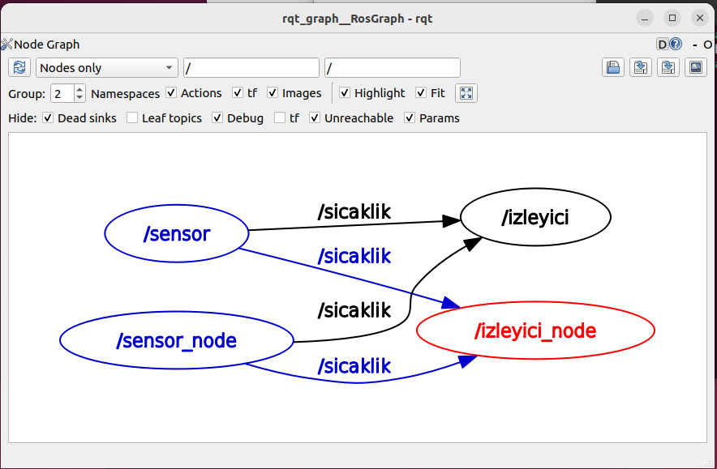
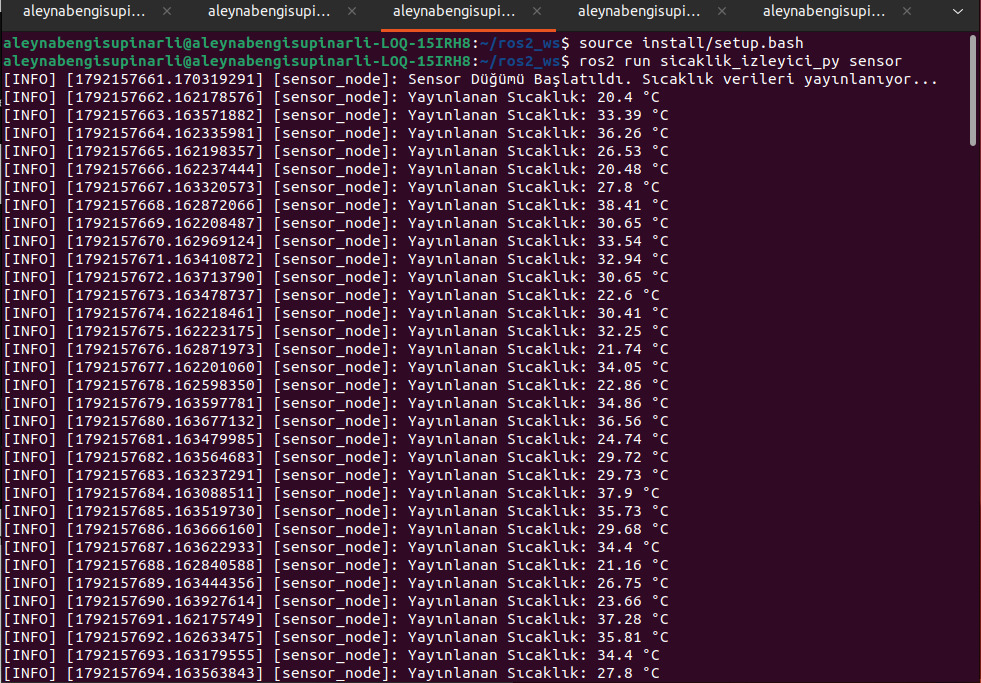
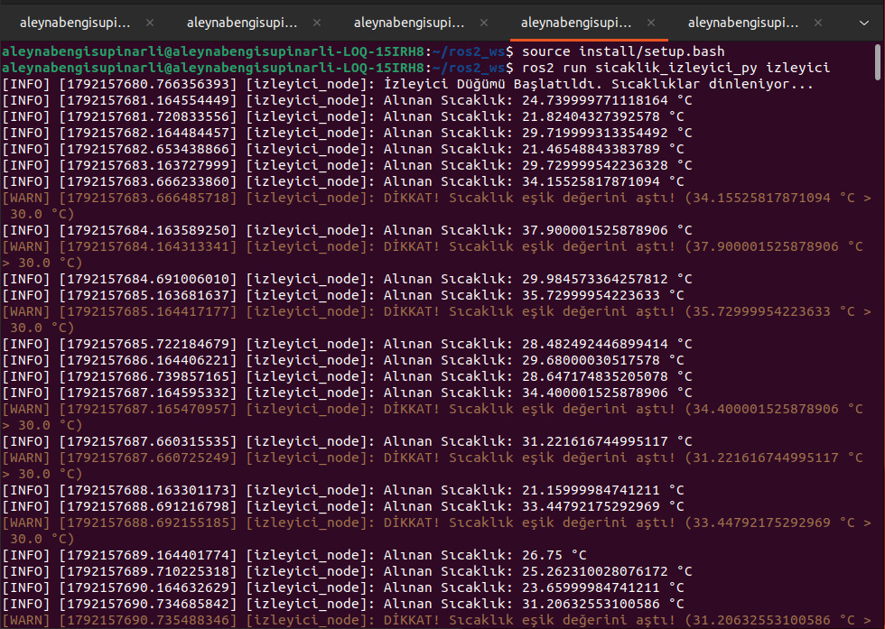

# 🌡️ Sıcaklık İzleyici ROS 2 Paketi (`sicaklik_izleyici_py`)

Bu proje, **ROS 2 Humble** ortamında Python (`ament_python`) kullanılarak geliştirilmiş bir sıcaklık izleme ve uyarı sistemidir. Sistem, rastgele sıcaklık verisi üreten bir sensör düğümü ile bu verileri dinleyip eşik değer kontrolü yapan bir izleyici düğümünden oluşmaktadır.

---

## 📌 Özellikler & Düğümler (Nodes)

1. **`sensor` (`sensor.py`)**:
   - `/sicaklik` konusuna (`std_msgs/msg/Float32`) **1 Hz** frekansında 20.0 °C ile 40.0 °C arasında rastgele sıcaklık değerleri yayınlar.
2. **`izleyici` (`izleyici.py`)**:
   - `/sicaklik` konusunu dinler.
   - Yayınlanan sıcaklık değerlerini ekrana basar.
   - Tanımlanan eşik değerini (`esik_deger`, varsayılan: **30.0 °C**) aşan sıcaklıklar için `[WARN]` uyarısı fırlatır.
   - **Bonus Özellik:** Eşik değeri ROS 2 parametresi (`declare_parameter`) olarak dinamik şekilde değiştirilebilir.

---

## 📊 Sistem Mimarisi ve Ekran Görüntüleri

### 1. RQT Graph Çıktısı
Düğümler ve topic (konu) arasındaki haberleşme ilişkisini gösteren grafik:



> **Grafik Açıklaması:** Bu görsel, ROS 2 ekosistemindeki publish-subscribe (yayıncı-abone) mimarisini açıkça ortaya koymaktadır. Şemada görüldüğü üzere, `/sensor` düğümü `std_msgs/msg/Float32` veri tipini kullanan `/sicaklik` adlı topic üzerinden veri yayınlamakta (`publisher`), `/izleyici` düğümü ise bu topic'i dinleyerek (`subscriber`) gelen sıcaklık verilerini anlık olarak işlemlemektedir. Bu grafik, düğümlerin birbirinden bağımsız ancak ortak bir kanal üzerinden başarılı bir şekilde haberleştiğini doğrulamaktadır.

---

### 2. Sensor Düğümü Çıktısı
Veri üreten yayıncı düğümünün terminal görüntüsü:



> **Terminal Çıktısı Açıklaması:** `sensor` düğümü başlatıldığında, sistemin aktif olduğuna dair bilgi logu (`[INFO]`) üretilir. Ardından her 1 saniyede bir (1 Hz frekansında), `random` kütüphanesi yardımıyla 20.0 °C ile 40.0 °C aralığında üretilen rastgele sıcaklık değerleri (`Yayınlanan Sıcaklık: X °C`) konsola yazdırılır ve eş zamanlı olarak `/sicaklik` konusuna (topic) servis edilir. Bu çıktı, düğümün zamanlayıcı (`timer`) mekanizmasının ve veri yayın döngüsünün kararlı bir şekilde çalıştığını göstermektedir.

---

### 3. İzleyici Düğümü Çıktısı
Verileri dinleyen ve eşik aşımında uyarı veren abone düğümün terminal görüntüsü:



> **Terminal Çıktısı Açıklaması:** `izleyici` düğümü, başlatıldığı esnada varsayılan eşik değerini (`30.0 °C`) parametre sisteminden okuyarak konsola loglar. Düğüm, `/sicaklik` konusundan gelen verileri dinlerken iki farklı senaryoya göre tepki verir:
> - Ölçülen değer eşik değerinin altındaysa normal akışta bilgi mesajı (`[INFO] Sıcaklık Normal`) üretir.
> - Ölçülen değer belirlenen eşik sınırını aştığında ise sistem otomatik olarak güvenlik protokolünü tetikler ve ekrana sarı/turuncu renkli dikkat çekici bir uyarı logu (`[WARN] YÜKSEK SICAKLIK UYARISI!`) yansıtır. Bu durum, hem abone mekanizmasının hem de koşullu uyarı mantığının hatasız çalıştığını kanıtlar.

---

## 🛠️ Kurulum ve Derleme

Çalışma alanınızı (workspace) oluşturduktan veya mevcut alanınıza girdikten sonra paketi derleyin:

```bash
cd ~/ros2_ws
colcon build --packages-select sicaklik_izleyici_py
source install/setup.bash
